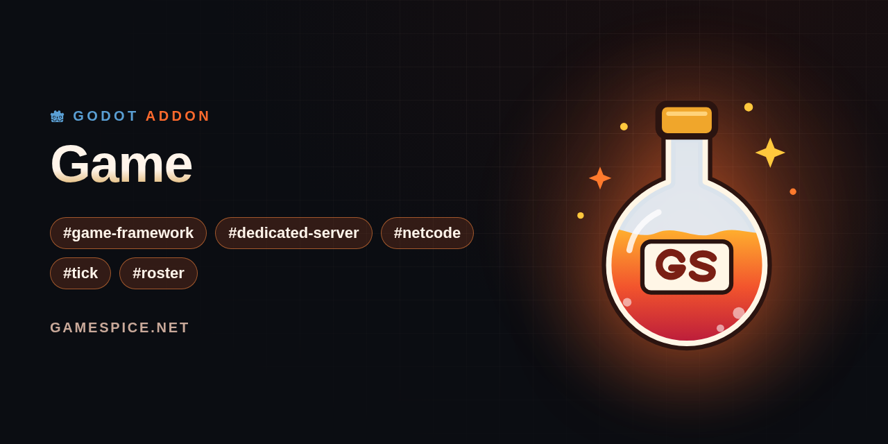

[](https://moddingcommunity.com/a/60-gs-game)

The shared wiring for a multiplayer Godot 4 game. Every server game in the family needed the same setup code: networking, player identity, services, a roster of who is playing, one authoritative tick, and a clean shutdown. GameSpice Game does that once, so your game only writes what is its own. It also has the client's platform layer (loading cover, menus, console, HUD, chat) and a set of tools shared by every game. Part of TMC's open source [**GameSpice**](https://gamespice.net) collection (MIT licence).

> This is a [GameSpice](https://gamespice.net) addon (MIT, built with Claude Code) and it ships a headless suite, `examples/game_selftest.tscn`. Every game in [Zee's Games](https://zeesgames.com) starts from it. Those games run on live servers, so the code here gets real use.

## Install

Copy `addons/gs_game/` into your project with [GameSpice Core](https://github.com/gamespice-platform/core), [GameSpice Server](https://github.com/gamespice-platform/server) and [GameSpice Net](https://github.com/gamespice-platform/net) (all three are required), and enable gs-game under **Project > Project Settings > Plugins**. [GameSpice Bootstrap](https://github.com/gamespice-platform/bootstrap) does this for a whole project.

Optional pieces (a map director, a vote, a services layer, gs-platform) are reached without being named, so you only need them if you use them.

## A server game in one file

A game is a `GSModule` the server loads. Subclass `GSGameModule` and fill in only what differs:

```gdscript
extends GSGameModule

const MyBridge := preload("net/my_bridge.gd")

func _module_name() -> String: return "mygame"
func _game_service() -> StringName: return MyGame.SERVICE

func _net_config() -> GSNetConfig:
    var config := GSNetConfig.new()
    config.tick_rate = game.tick_rate
    config.snapshot_rate = 32
    return config

func _make_bridge() -> Node: return MyBridge.new()
func _make_identity() -> Node: return MyIdentity.new()
func _make_services() -> Node: return MyServices.new()

func _game_load() -> GSResult:
    add_command("mygame_status", _cmd_status, "Show the match state")
    return GSResult.success(null)
```

`examples/fixtures/test_module.gd` is a complete working module.

## What is in it

| Piece | What it does |
| --- | --- |
| `GSGameModule` | Builds the netcode, bridge, identity and services in order, drives the tick, and tears everything down in reverse. `report_map(id)` tells the server which map you are on, so server listings show it. |
| `GSGameNetcode` | Builds a `GSNetManager` with the right settings and attaches your bridge. Usable alone. |
| `GSGameRoster` | Who is in the game, as opposed to who is connected, and everything that must hear when that changes. |
| `GSGameServices`, hooks | The services layer every game needs: relay, rules and voice range. See [docs/services.md](docs/services.md). |
| `GSPlayerGameServices` | `GSGameServices` with the stock admin abilities, teleport and team seams for a round game with a `players` dictionary. See [docs/services.md](docs/services.md). |
| `GSGameClient` | The client's platform layer: a loading cover (held until the player exists and a camera is current), the settings and Escape menu, console, HUD in the player's theme, Tab scoreboard, M map menu, pointer handling, chat keys, one `input_blocked_changed` signal, and a `user://` flush on exit in a browser. Each piece can be switched off or replaced. See [docs/client-migration.md](docs/client-migration.md). |
| `GSGameChatClient` | Chat box and push-to-talk, with the server's lines and the player's block list. |
| Avatar actions | Emotes, poses and gestures checked by the server and played on every client. [docs/avatar-actions.md](docs/avatar-actions.md) |
| `GSGameConfigBinder` | Turns a game's config class into settings an operator can change. [docs/config-binder.md](docs/config-binder.md) |
| Per-map settings and map edit commands | [docs/map-config.md](docs/map-config.md), [docs/map-edit.md](docs/map-edit.md) |
| `GSGameNoblock` | Teammates pass through each other, enemies stop. [docs/noblock.md](docs/noblock.md) |
| Touch controls | On-screen buttons for phones. [docs/touch-controls.md](docs/touch-controls.md), [docs/touch-layout.md](docs/touch-layout.md) |
| `GSGameWorkbench` | Hosts GameSpice Workbench inside a game. [docs/workbench.md](docs/workbench.md) |
| QA tools | Perf bench, filmstrip, phone screenshots, netchaos and more, shared by every game. [docs/qa.md](docs/qa.md) |

## What it leaves out

GameSpice Game has no rules. Whether a round ended, what a team is, what the objective is and who won belong to [GameSpice Match](https://github.com/gamespice-platform/match) and [GameSpice Objective](https://github.com/gamespice-platform/objective). A game can use neither and still use this.

A feature belongs here only if every game would write it the same way with just the class names changed. A map rotation does not qualify, so the roster only tells a rotation that someone left (it calls `follow()` on it) and does not know what a rotation is.

## Netcode settings that are fixed

`GSGameNetcode` fixes four settings. Each one is a real mistake if left at the Godot default:

| Setting | Value | Why |
| --- | --- | --- |
| `auto_tick` | false | Your game's tick runs inside the netcode's, between applying inputs and building the snapshot. A second ticker moves every player twice (double speed, only while someone is connected). |
| `config_file` | empty | By default the manager reads a JSON file, so a stale one in `user://` could change a tick rate you did not choose. |
| `local_peer_id` | 1 | The authority's id in Godot's multiplayer, which the bridge routes by. |
| `messages.seal()` | called last | Wire ids come from sorting registered type names. A type registered after the seal renumbers every id above it. |

Tick rate, snapshot rate and world extent have no default: no value is right for two different games, so you set them in `_net_config()`.

## More documentation

[docs/design.md](docs/design.md) explains the shape of the code. [docs/api-levels.md](docs/api-levels.md) lists what each API level added. [docs/history.md](docs/history.md) lists bugs worth recognising if they return. [docs/rsi-asset-audit.md](docs/rsi-asset-audit.md) explains the weapon asset audit (models, textures per video-quality tier, reload clips) that Nightly runs on every weapon pack.

## Testing

```bash
godot --headless --path . --import
timeout 200 godot --headless --path . res://examples/game_selftest.tscn
```

The suite checks the setup sequence in order, the roster driven by real server events, the tick reaching the bridge before the game, an unload that leaves nothing running, every failure path unwinding what it had built, and `GSGameClient` with stand-ins and without GameSpice Menu or GameSpice Console. Other suites are in `examples/`.

## Used by

These games ship a copy of it:

- [Fatal Contact](https://zeesgames.com/fatal-contact)
- [Airdrift](https://zeesgames.com/airdrift)
- [Playlot](https://zeesgames.com/playlot)
- [Hungario](https://zeesgames.com/hungario)
- [Buses From Hell](https://zeesgames.com/buses-from-hell)
- [Smash Copter](https://zeesgames.com/smash-copter)
- [Zombie Zone](https://zeesgames.com/zombie-zone)
- [Hide n Seek](https://zeesgames.com/hide-n-seek)
- [Prop Hunt](https://zeesgames.com/prop-hunt)
- [Murder Mystery](https://zeesgames.com/murder-mystery)
- [Deathrun](https://zeesgames.com/deathrun)
- [Wipeout](https://zeesgames.com/wipeout)
- [Dangerous Delivery](https://zeesgames.com/dangerous-delivery)
- [Look At Me](https://zeesgames.com/look-at-me)

The whole collection is at [zeesgames.com](https://zeesgames.com).

## Licence

MIT. See [LICENSE](LICENSE).
